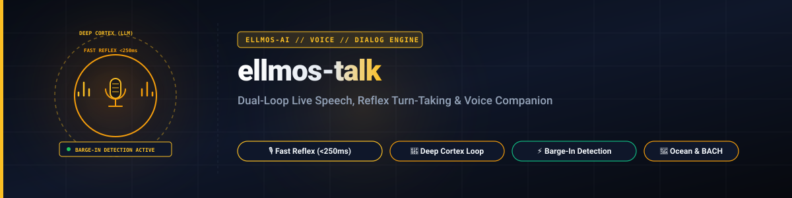

<p align="center">
  
</p>

# ellmos-talk

**English** | [Deutsch](README_de.md)

Dual-loop live speech and visual companion engine for the ellmos ecosystem (BACH, Open Ocean). It is a small, dependency-free Python package that holds the **conversation logic**: a fast, rule-based reflex for turn-taking, a sentence-streaming adapter for a main model, and a model-controlled visual state that a companion window can render.

> **Status: early (v0.1.0).** This package contains the engine, the state model and the directive parser. It does **not** contain audio capture, speech-to-text, text-to-speech or the visualization window itself. The default reply of the cortex loop is a canned placeholder unless you inject a responder.

## What it does

1. **`FastReflexLoop`** decides within one call what to do with an utterance: `continue`, `barge_in`, `backchannel`, `hand_off_to_cortex` or `wake_triggered`.
   - It is **deterministic and rule-based** (regular expressions and keyword lists). The `model_name` field (default `smollm2:360m`) is stored as a label for a fast relay model; no model is loaded or called in this package.
   - Speaking mode plus any new input, a bare "stop / stopp / halt / wait / pause", or a bare wake word (default `hey buddha`) produces a barge-in or wake reaction with a short backchannel text (German or English).
   - Other utterances are handed to the cortex with an emotion hint (`calm`, `curious`, `joyful`, `focused`).
2. **`DeepCortexLoop`** wraps the main model.
   - `stream_sentences(text)` splits a reply into sentence chunks so a TTS stage can start with the first sentence.
   - `generate_response(...)` calls an optional `responder(prompt, persona, language)` callable that you pass in. Without one, it returns a fixed placeholder reply.
3. **`TalkEngine`** ties both together with a `TalkVisualState` and offers `process_turn`, `preview_reflex`, `summon_by_model`, `acknowledge_summon`, `update_visual_state` and `status`.
4. **`<talk_control {...} />` directives** let the model steer the companion state inline. `extract_talk_directives(text)` removes them from the spoken text and returns the parsed JSON; `apply_talk_directive(state, directive)` validates and applies them.

### Visual state values

| Field | Allowed values |
|---|---|
| `pattern` | `orb`, `wave`, `rings`, `constellation`, `pulse` |
| `emotion` | `calm`, `curious`, `joyful`, `focused`, `empathetic`, `alert` (each sets a color palette) |
| `mode` | `listening`, `speaking`, `thinking`, `idle`, `muted` |
| `persona` | `buddha`, `gemini`, `claude`, `codex` |
| `language` | `de`, `en`, `es`, `fr`, `zh`, `ja`, `ru`, `ar`, `pt`, `hi`, `it` |
| `operating_mode` | `ptt`, `duplex`, `wake_word`, `off` |
| `summon_policy` | `knock`, `auto_popup`, `muted` |
| `client_runtime` | `browser`, `tauri`, `mobile`, `companion` |

Further fields: `emoji_overlay`, `wake_word`, `wake_word_enabled`, `speed_hz` (0.1 to 5.0), `bound_slot`, `primary_model`, `fast_relay_model`, device ids for input, output and camera. Invalid values raise `ValueError`. `DEFAULT_TALK_MODEL_BUNDLE` is a data catalog of suggested relay, STT, TTS and VAD/wake models; nothing here downloads or runs them.

A model can open a session via `summon_by_model(...)`: depending on `summon_policy` and presence the result is `auto_popup`, `knock` or `suppressed`.

## Installation

Requires Python 3.10 or newer; there are no runtime dependencies. From a clone:

```bash
pip install -e .
# optional extras declared in pyproject.toml
pip install -e ".[dev]"     # pytest
pip install -e ".[voice]"   # declares ellmos-voice-io; not imported by this package yet
```

## Usage

```bash
ellmos-talk status
ellmos-talk turn "Why is the build failing?" --persona claude --lang en
ellmos-talk directive '{"pattern": "wave", "emotion": "curious", "mode": "thinking"}'
```

```python
from ellmos_talk import TalkEngine

engine = TalkEngine()
result = engine.process_turn(
    "How do I start?",
    model_response='<talk_control {"emotion": "joyful"} /> Let us begin. First, open the project.',
)
print(result.sentence_chunks)   # ['Let us begin.', 'First, open the project.']
print(result.visual_state["emotion"])
```

Tests live in `tests/test_talk_engine.py` (run with `pytest`).

## Relation to ellmos and Open Ocean

`ellmos-talk` is one of the extension modules listed in the [Open Ocean](https://github.com/ellmos-ai/open-ocean) module map. It is meant to be paired with [ellmos-voice-io](https://github.com/ellmos-ai/ellmos-voice-io) for speech input and output; that wiring is not part of this repository yet. Module metadata is in `ellmos-module.v2.json`.

## License

MIT, as declared in `pyproject.toml`.
