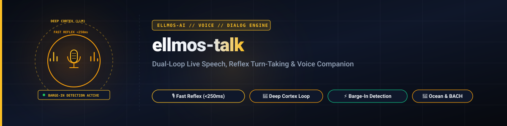
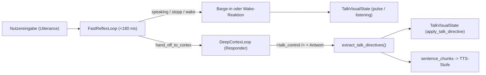
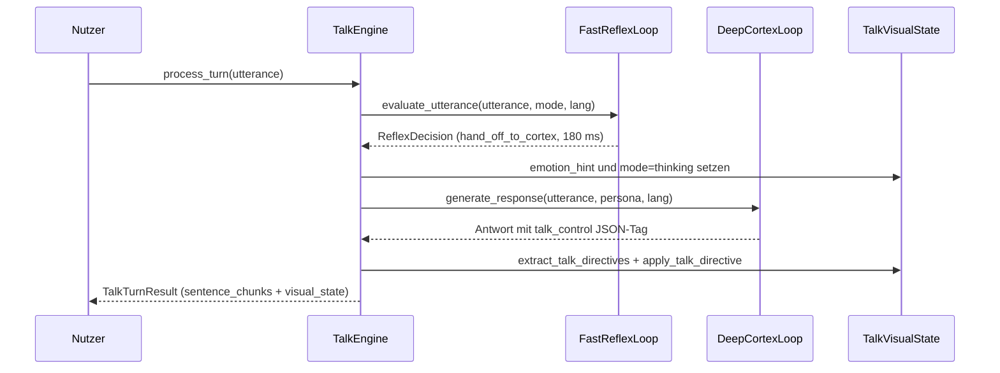
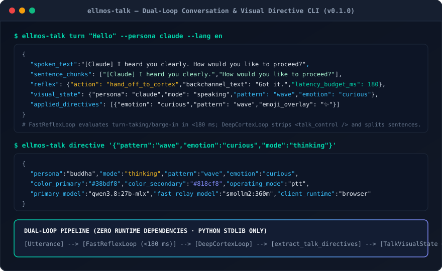

<p align="center">
  
</p>

# ellmos-talk

[English](README.md) | **Deutsch**

[](pyproject.toml)
[](LICENSE)
[-brightgreen.svg)](pyproject.toml)
[-blue.svg)](src/ellmos_talk/py.typed)
[](tests/)
[](CHANGELOG.md)
[](llms.txt)

Dual-Loop-Engine für Live-Gespräch und visuellen Begleiter im ellmos-Ökosystem (BACH, Open Ocean). Ein kleines, abhängigkeitsfreies Python-Paket mit der **Gesprächslogik**: ein schneller, regelbasierter Reflex für das Sprecherwechsel-Verhalten, ein Satz-Streaming-Adapter für ein Hauptmodell und ein vom Modell gesteuerter visueller Zustand, den ein Begleiterfenster darstellen kann.

> **Status: early (v0.1.0).** Dieses Paket enthält die Engine, das Zustandsmodell und den Direktiven-Parser. Es enthält **keine** Audioaufnahme, Spracherkennung, Sprachausgabe und auch nicht das Visualisierungsfenster selbst. Die Standardantwort der Cortex-Schleife ist ein fester Platzhalter, solange kein eigener Responder übergeben wird.

---

## Inhalt

1. [Architektur & Dual-Loop-Ablauf](#sec-01-architektur)
2. [Funktionen](#sec-02-funktionen)
3. [Visueller Zustand & Modelldirektiven](#sec-03-visueller-zustand)
4. [Installation](#sec-04-installation)
5. [Mit deinem LLM installieren](#sec-05-llm-installation)
6. [Nutzung & CLI-Workflow-Vorschau](#sec-06-nutzung)
7. [Bezug zu ellmos und Open Ocean](#sec-07-oekosystem)
8. [Governance, Sicherheit & Lizenz](#sec-08-governance)

---

<a id="sec-01-architektur"></a>
## 1. Architektur & Dual-Loop-Ablauf





---

<a id="sec-02-funktionen"></a>
## 2. Funktionen

1. **`FastReflexLoop`** entscheidet pro Aufruf, wie mit einer Äußerung umzugehen ist: `continue`, `barge_in`, `backchannel`, `hand_off_to_cortex` oder `wake_triggered`.
   - Er arbeitet **deterministisch und regelbasiert** (reguläre Ausdrücke und Stichwortlisten). Das Feld `model_name` (Standard `smollm2:360m`) wird nur als Bezeichnung eines schnellen Relay-Modells gespeichert; in diesem Paket wird kein Modell geladen oder aufgerufen.
   - Neue Eingabe im Modus `speaking`, ein alleinstehendes „stop / stopp / halt / warte (kurz) / wait / pause" oder das alleinstehende Weckwort (Standard `hey buddha`) führt zu Unterbrechung bzw. Wake-Reaktion mit kurzem Rückmeldetext (Deutsch oder Englisch).
   - Alle anderen Äußerungen gehen mit einem Emotionshinweis (`calm`, `curious`, `joyful`, `focused`) an den Cortex.
2. **`DeepCortexLoop`** kapselt das Hauptmodell.
   - `stream_sentences(text)` teilt eine Antwort in Satzstücke, damit eine TTS-Stufe schon mit dem ersten Satz beginnen kann.
   - `generate_response(...)` ruft einen optional übergebenen `responder(prompt, persona, language)` auf. Ohne ihn kommt eine feste Platzhalterantwort.
3. **`TalkEngine`** verbindet beides mit einem `TalkVisualState` und bietet `process_turn`, `preview_reflex`, `summon_by_model`, `acknowledge_summon`, `update_visual_state` und `status`.
4. **`<talk_control {...} />`-Direktiven** lassen das Modell den Begleiterzustand direkt im Text steuern. `extract_talk_directives(text)` entfernt sie aus dem Sprechtext und liefert das geparste JSON; `apply_talk_directive(state, directive)` prüft und übernimmt sie.

---

<a id="sec-03-visueller-zustand"></a>
## 3. Visueller Zustand & Modelldirektiven

| Feld | Erlaubte Werte |
|---|---|
| `pattern` | `orb`, `wave`, `rings`, `constellation`, `pulse` |
| `emotion` | `calm`, `curious`, `joyful`, `focused`, `empathetic`, `alert` (setzt jeweils eine Farbpalette) |
| `mode` | `listening`, `speaking`, `thinking`, `idle`, `muted` |
| `persona` | `buddha`, `gemini`, `claude`, `codex` |
| `language` | `de`, `en`, `es`, `fr`, `zh`, `ja`, `ru`, `ar`, `pt`, `hi`, `it` |
| `operating_mode` | `ptt`, `duplex`, `wake_word`, `off` |
| `summon_policy` | `knock`, `auto_popup`, `muted` |
| `client_runtime` | `browser`, `tauri`, `mobile`, `companion` |

Weitere Felder: `emoji_overlay`, `wake_word`, `wake_word_enabled`, `speed_hz` (`0,1` bis `5,0`), `bound_slot`, `primary_model`, `fast_relay_model` sowie Geräte-IDs für Eingabe, Ausgabe und Kamera. Ungültige Werte lösen `ValueError` aus. `DEFAULT_TALK_MODEL_BUNDLE` ist ein reiner Datenkatalog vorgeschlagener Relay-, STT-, TTS- und VAD-/Wake-Modelle; nichts davon wird hier geladen oder ausgeführt.

Ein Modell kann über `summon_by_model(...)` eine Sitzung eröffnen: Je nach `summon_policy` und Anwesenheit lautet das Ergebnis `auto_popup`, `knock` oder `suppressed`.

---

<a id="sec-04-installation"></a>
## 4. Installation

Benötigt Python 3.10 oder neuer; es gibt keine Laufzeitabhängigkeiten. Aus einem Klon:

```bash
python -m venv .venv
# Linux/macOS: source .venv/bin/activate | Windows: .venv\Scripts\activate
pip install -e .

# Optionale Extras aus pyproject.toml
pip install -e ".[dev]"     # pytest und ruff
pip install -e ".[voice]"   # deklariert ellmos-voice-io; wird von diesem Paket noch nicht importiert
```

---

<a id="sec-05-llm-installation"></a>
## 5. Mit deinem LLM installieren

Kopiere diesen Prompt in deinen Coding-Agenten oder LLM-Assistenten für eine geprüfte Einrichtung (siehe [llms.txt](llms.txt) und [SKILL.md](SKILL.md)):

```text
Installiere und verifiziere https://github.com/ellmos-ai/ellmos-talk (Release-Tag/Commit-Pin bevorzugen, keine ungeprüften curl|sh-Pipes):
1. Lies zuerst llms.txt und SKILL.md im Repo-Root.
2. Erstelle eine isolierte Python-3.10+-Umgebung (.venv) und führe den Installationsbefehl aus llms.txt aus.
3. Prüfe die Installation mit `ellmos-talk --help`, `python -m ellmos_talk.cli status` sowie `pytest -ra -v` und berichte das Ergebnis.
```

Maschinenlesbare Einstiegspunkte: [SKILL.md](SKILL.md) · [llms.txt](llms.txt) · [llm.txt](llm.txt)

---

<a id="sec-06-nutzung"></a>
## 6. Nutzung & CLI-Workflow-Vorschau

<p align="center">
  
</p>

```bash
ellmos-talk status
ellmos-talk turn "Warum schlägt der Build fehl?" --persona claude --lang de
ellmos-talk directive '{"pattern": "wave", "emotion": "curious", "mode": "thinking"}'
```

```python
from ellmos_talk import TalkEngine

engine = TalkEngine()
result = engine.process_turn(
    "Wie fange ich an?",
    model_response='<talk_control {"emotion": "joyful"} /> Fangen wir an. Öffne zuerst das Projekt.',
)
print(result.sentence_chunks)   # ['Fangen wir an.', 'Öffne zuerst das Projekt.']
print(result.visual_state["emotion"])
```

Die Tests liegen in `tests/test_talk_engine.py` und `tests/test_metadata.py` (Aufruf mit `pytest -ra -v`).

---

<a id="sec-07-oekosystem"></a>
## 7. Bezug zu ellmos und Open Ocean

`ellmos-talk` gehört zu den Erweiterungsmodulen in der Modulzuordnung von [Open Ocean](https://github.com/ellmos-ai/open-ocean). Es ist dafür gedacht, mit [ellmos-voice-io](https://github.com/ellmos-ai/ellmos-voice-io) für Spracheingabe und -ausgabe kombiniert zu werden; diese Anbindung ist noch nicht Teil dieses Repositories. Die Modul-Metadaten stehen in [ellmos-module.v2.json](ellmos-module.v2.json).

---

<a id="sec-08-governance"></a>
## 8. Governance, Sicherheit & Lizenz

- **Lizenz:** [MIT](LICENSE), wie in [pyproject.toml](pyproject.toml) angegeben
- **Sicherheitsrichtlinie:** [SECURITY.md](SECURITY.md)
- **Beitragsrichtlinie:** [CONTRIBUTING.md](CONTRIBUTING.md)
- **Verhaltenskodex:** [CODE_OF_CONDUCT.md](CODE_OF_CONDUCT.md)
- **Änderungsprotokoll:** [CHANGELOG.md](CHANGELOG.md)

<sub>Idee & Abnahme: Geiger · Textassistenz: LLM-gestützt · Grafik: SVG-generiert</sub>
